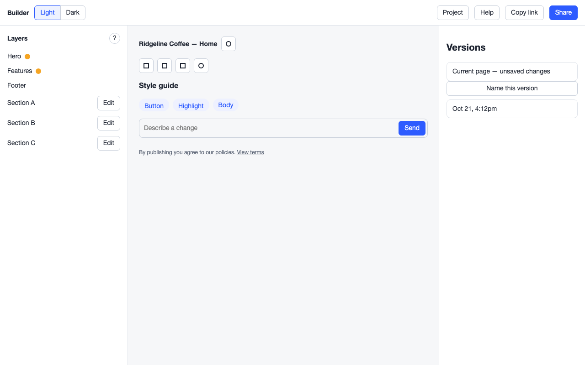
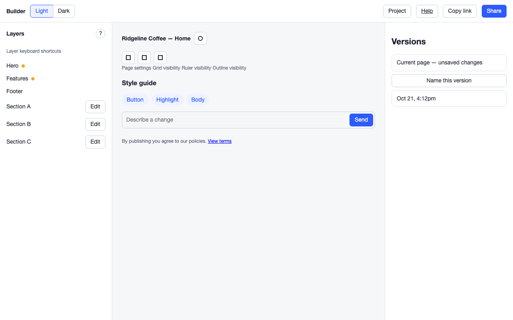

# Idiom

Design acceptance for AI-built software: Idiom opens your running app in a real browser, uses it the way a person would, finds the UI and UX defects a careful designer would catch, hands each one to your coding agent as a fix, and keeps them from coming back.

## Who it's for

Anyone building UI with AI coding agents such as Claude Code, Codex or Cursor. Idiom judges what actually renders, across every state, viewport and colour scheme, rather than the source code. It runs on its own from the terminal or CI. If you use Autobuild, it plugs in as a verify step, but it doesn't need Autobuild.

## How it works

1. **Check**: `idiom check <flow>` renders every state you declare at each viewport and colour scheme (`idiom quick <url>` does the same for the pages you name, with no setup) and runs more than 60 measured checks: contrast, broken links and images, fonts that fail to load, missing focus styles, controls that do nothing, duplicate entry points, content that jumps when you act, actions with no loading state or that can be submitted twice, failures with no error message or no way to retry, changes that snap with no transition, spacing, alignment, sizes off your design system and more ([docs/rules.md](docs/rules.md)). Top issues come first, ranked by how noticeable each problem is and how prominent the element is ([ranking](docs/ranking.md)); symptoms that share one cause are grouped into one issue. Capture waits for entrance animations to finish, then only what is actually on screen is judged: content in a closed menu or collapsed section, and hidden, fully transparent or clipped-away elements are skipped and counted in the report, not measured.
2. **Fix**: every finding names the element, the measurement and when it counts as fixed, with a cropped screenshot. `idiom fix <flow>` hands the top findings to Claude Code or Codex, then recaptures to verify each repair.
3. **Guard**: `idiom check --changed` checks only the states your Git changes affect, following routes and imports, and lists the states it skipped. The first `idiom check` on a committed HEAD records today's findings as a baseline. After that, checks and the GitHub Action fail only on new findings. Accept and reject decisions are stored in the repo, so a settled finding stays settled.

To find out whether controls work, Idiom probes them within coverage and time budgets, reuses equivalent results across states, and captures states concurrently. Probes restore the state between interactions. Idiom blocks every request that could change data (anything but GET, HEAD and OPTIONS), except the setup steps you declare. `idiom quick` probes too, more strictly, within 45 seconds per page (`--no-probe` to skip).

Screenshots only show the states either side of an action, so Idiom also records what happens during it. Every page load, web step and probe click gets a timeline: layout shifts (including those right after input), elements that moved and when, content inserted or removed, animations and transitions, and the requests the action started. Actions that send requests are replayed with the responses held, as a slow network would, to see what the user waits through, and again with the request failing (answered locally, never reaching your server) to see whether the user is told and can retry. Findings that happen between states come with a filmstrip, a contact sheet of frames showing what the user saw.

Under the hood the loop is Learn → Render → Critique → Repair → Verify → Remember.

## Compare against your design

Point Idiom at the design you meant and it reports where the build drifts: size, position, spacing, radius, typography, colour, and content that is missing or extra. Against an image it reports the regions that visibly changed.

| Source | How |
| --- | --- |
| Figma frame | Frame URL with `node-id`; needs a personal access token in `FIGMA_TOKEN`. Frames are pinned under `.idiom/designs/`. |
| Claude Design or HTML | An exported HTML file or folder, a public HTML prototype, or an accessible Claude rendered preview |
| Image | A PNG, JPEG or WebP mockup or screenshot |
| Live site | A public page, declared with `site` in a flow; quick accepts its URL |

```sh
idiom design add checkout ./designs/checkout.png
idiom design add checkout "https://www.figma.com/design/<file>/Checkout?node-id=12-34" --name figma
idiom check store
```

For one page with no setup, add `--design <source>` to `idiom quick`.

`idiom design add` takes a Figma frame, HTML or an image. Declare a live site as `{ "site": "<url>" }` in the flow file. When element references disagree, `idiom decide --choose` records the intended reference for that element/property. See the [design comparison guide](docs/design-compare.md).

When the same off-scale value keeps appearing in one place, for example 17px padding on every table-row control between 16px and 24px steps, Idiom asks one question instead of filing every occurrence: add a step to your design system, or keep reporting it as drift. Answer with `idiom ruling`; Idiom never changes DESIGN.md without a recorded answer.

## Use it from your agent

`idiom mcp` serves fifteen Idiom tools over MCP stdio, covering the loop from init through check, fix plan, decisions, verify, sweep and baseline; [docs/mcp.md](docs/mcp.md) has the CLI parity table. For Claude Code:

```sh
claude mcp add idiom -- npx -y @mattskilly/idiom mcp
```

In Claude Code, the bundled plugin reminds the agent which flows to check after it edits UI files, and once more before it stops if the UI changed since its last check. Codex, Cursor and Claude Desktop setup, tool timeouts and the plugin are in [docs/mcp.md](docs/mcp.md).

After an autonomous build, `idiom sweep --all` captures every flow and groups findings that share a cause into one ranked cleanup set, emitting at most 10 repair tickets for you to triage.

## Before and after





These are Idiom's benchmark fixture pages in `test/fixtures/benchmark/`, a reconstruction of an AI-built editor with seven defects that a human reviewer found and an earlier version of Idiom missed. The test suite checks that, with no configuration beyond the fixture's `DESIGN.md`, Idiom reports all seven on the before page and none on the after page. Results on real apps vary with how much of the app a flow covers.

- a bare "?" beside the Layers heading
- Page settings reachable three ways
- override dots at 12px against an 8px design
- Button / Highlight specimen text below centre
- composer input touching Send; Versions cards flush with their button
- "Name this version" does nothing
- "View terms" and the top-bar Help as disabled navigation buttons

## Install

You need Node 20 or newer. Install the CLI globally with npm or Bun:

```sh
npm install -g @mattskilly/idiom
# or: bun add -g @mattskilly/idiom
idiom --version
```

The version command prints `<version> (<short source commit>)`, for example `0.13.0 (a85659a)`. To pin a project to an exact release instead, add it as a dev dependency (`bun add -d --exact @mattskilly/idiom@0.13.0`) and run it with `bunx idiom` or `npx idiom`.

### Browser setup

Capture also needs the Playwright-managed Chromium binary once per machine. Its version deliberately matches the exact runtime dependency in this tag:

```sh
bunx playwright@1.62.1 install chromium
# or: npx playwright@1.62.1 install chromium
```

In a Linux CI image, install Chromium and its operating-system dependencies with:

```sh
bunx playwright@1.62.1 install --with-deps chromium
```

Browser installation is separate because it may require network and elevated system-package access.

## Try Idiom in two minutes

Start the application yourself, then point Idiom at one or more public pages from the same origin:

```sh
cd /path/to/any/uninitialized-directory
idiom quick http://127.0.0.1:3000/
```

Add explicit pages to the same command when you already know the routes; Idiom preserves their order and does not crawl links or submit forms:

```sh
idiom quick \
  http://127.0.0.1:3000/ \
  http://127.0.0.1:3000/pricing \
  http://127.0.0.1:3000/contact
```

The command captures every supplied page at desktop (1440×900) and mobile (390×844) sizes in both light and dark colour schemes. It runs the deterministic checks and prints the exact `report.md` and `report.html` paths, beneath `idiom-quick-reports/` unless you pass `--out <dir>`.

Quick review needs no Idiom files, flow manifest or model credentials. Its final **Quick-review limits** section names what a public-page pass cannot cover, such as authenticated surfaces and fixture-driven states; run `idiom init` to cover those. Details are in [docs/commands.md](docs/commands.md#quick).

## Go deeper with configured flows

Quick review is the entry point, not the coverage ceiling. Configure a flow when you need authenticated surfaces, interaction destinations, error and empty states, product-specific design guidance, durable decisions, or before/after verification:

```sh
idiom init --yes          # scaffold PRODUCT.md, DESIGN.md and .idiom/
idiom init --flows        # draft flows from your routes (real HTML pages only)
idiom validate home       # after defining .idiom/flows/home.json
idiom check home          # every deterministic finding; records the baseline
idiom review home         # deterministic + model critique
```

- [docs/commands.md](docs/commands.md): every command, its flags and its output.
- [docs/configuration.md](docs/configuration.md): the project file, flows, checks and baselines.
- [docs/rules.md](docs/rules.md): every rule, why it matters, its severity and source, and how to configure or decide it.
- [GitHub Action](docs/configuration.md#github-action) and [Autobuild wiring](docs/configuration.md#autobuild) for pull-request and build gates.

## Update Idiom

```sh
npm install -g @mattskilly/idiom@latest
# or: bun add -g @mattskilly/idiom@latest
idiom --version
```

Check [CHANGELOG.md](CHANGELOG.md) for new configuration before updating a pinned project.

## Local development

Maintainers working from a clone can build and link the checkout instead:

```sh
bun install
bun run build
bun link
```

`npm link` is the Node-only alternative. These clone/link instructions are for repository development, not external installation.

## Documentation

| Doc | Purpose |
| --- | --- |
| [docs/commands.md](docs/commands.md) | Every command, its flags and its output |
| [docs/configuration.md](docs/configuration.md) | Project file, flows, checks, baselines, Autobuild and the GitHub Action |
| [docs/rules.md](docs/rules.md) | Every rule: what it catches, why, severity, source, and how to configure or decide it |
| [docs/design-compare.md](docs/design-compare.md) | Compare against HTML, Figma, images and live sites; resolve conflicting intent |
| [docs/mcp.md](docs/mcp.md) | MCP tools and client setup for coding agents |
| [docs/ranking.md](docs/ranking.md) | How top issues are ranked and grouped |
| [CHANGELOG.md](CHANGELOG.md) | User-visible changes in every released version |
| [docs/architecture.md](docs/architecture.md) | Technical architecture and Autobuild seam |
| [docs/releases.md](docs/releases.md) | Maintainer release checklist |
| [docs/schemas.md](docs/schemas.md) | Project, flow, finding, and decision record schemas |

**Every state, not every page. Build in your idiom.**

## License

Idiom is licensed under the [Apache License 2.0](LICENSE).
